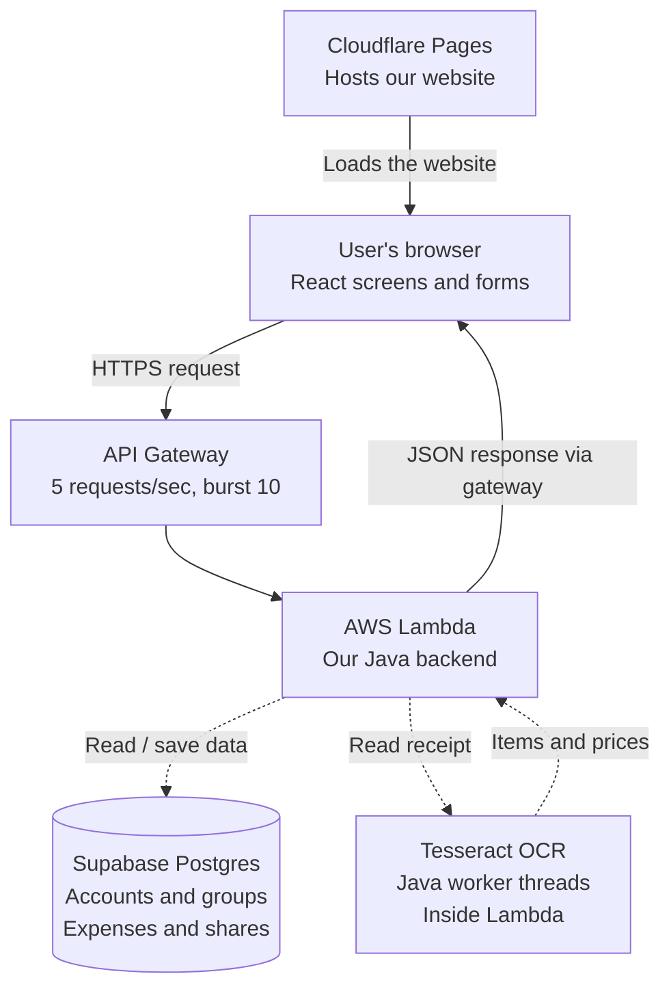
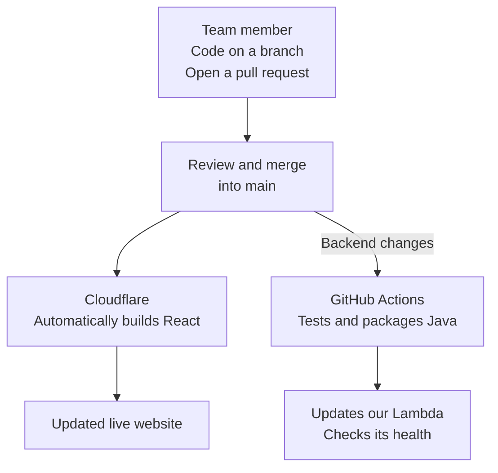

# CSCI 201 Team 3: group expense tracker

React frontend, Java 21 AWS Lambda backend, and Supabase Postgres.
This repository is a starter, not the completed course project.
There is no Spring Boot dependency.

- [Live starter](https://csci201-expense-tracker.pages.dev)
- [Java health endpoint](https://mu0qe823ue.execute-api.us-west-2.amazonaws.com/health)
- [Build and deployment runs](https://github.com/acesava/CSCI201-Team3/actions)

## How our app works

Cloudflare delivers the React website to the user's browser.
React sends requests to Java and displays the results Java sends back.



**Working now:** the website and Java health check.
**Still to build:** Java login, permissions, expense splitting, database integration, and receipt reading.
Dashed arrows show planned connections.
Users will also be able to enter expenses manually without uploading a receipt.

## How our changes go live



No manual deployment button is needed for normal frontend or backend changes merged into `main`.
The separate **Build and test** workflow checks pull requests before merging.
Supabase database changes are not automatically deployed yet.

## Start locally

Install Node.js 22 and a JDK 21.
Maven is downloaded automatically by the checked-in wrapper.
Clone `https://github.com/acesava/CSCI201-Team3.git`, then run these commands from its folder:

```sh
cd frontend
npm ci
cp .env.example .env.local
# Windows PowerShell: Copy-Item .env.example .env.local
npm run dev
```

Open **http://localhost:5173** and click **Check backend**.
The example environment file contains our public Java API URL, not a secret.
Use `localhost`, not `127.0.0.1`: API Gateway's current CORS settings allow the former on port 5173.
If port 5173 is busy, stop your previous dev server; Vite will report the conflict instead of silently picking an unsupported port.

In another terminal, starting from the repository root, test and package Java:

```sh
cd backend
./mvnw verify
# Windows: .\mvnw.cmd verify
```

The deployment artifact is `backend/target/expense-api.jar`.
The Lambda handler is `edu.usc.csci201.team3.Handler::handleRequest`.
`GET /health` is the only implemented route.
All other routes return 404, and non-GET requests to `/health` return 405.

The Java backend is a Lambda handler, not a local HTTP server.
These Maven commands run tests and create the deployment package; the frontend connects to the shared deployed API.
Restart Vite after changing `VITE_API_BASE_URL` in `frontend/.env.local`.
The page's connection check uses a real HTTP request; without a configured URL it reports that setup is incomplete.

## API rate limiting

Public requests go through API Gateway before reaching Lambda.
The shared limit targets **5 requests per second with a burst capacity of 10**, across all users, not per person.
Excess requests receive HTTP `429`; wait a few seconds and retry instead of looping immediately.
Normal users do not need AWS accounts or AWS keys.
The legacy direct Lambda URL requires AWS IAM authentication and is no longer an anonymous bypass.

**Existing local setup:** replace only `VITE_API_BASE_URL` in `frontend/.env.local` with the value in `.env.example`, then restart Vite.
Do not overwrite other local environment settings.
The live website and deployment workflow use this gateway too.

Throttling is best effort and is not a spending cap or a guarantee of availability.
A sustained attacker can still consume gateway requests and compete with normal users for the shared allowance.
The Java entry point also enforces 30 requests per public IP per fixed 10-second window using a shared DynamoDB counter.
This includes health checks and unimplemented routes; it is independent of account login.
API Gateway supplies the IP; caller-provided forwarding headers are ignored.
Responses include `Retry-After` on `429`; wait before retrying.
People sharing a campus or home public IP share this allowance, and IP rotation can evade it.
A fixed-window boundary can permit two adjacent bursts; the gateway throttle still applies.
The Java guard runs inside Lambda, so rejected requests still use some Lambda and counter capacity.
Counter failure returns `503` rather than allowing unchecked business operations.
Before adding private data or OCR, implement login, permission checks, and per-user operation quotas.
See [rate-limit configuration](infrastructure/SETUP.md#api-throttling) for the dashboard and setup script.

## Folder responsibilities

| Folder | What belongs here |
| --- | --- |
| `frontend/` | React screens, forms, charts, and calls to Java |
| `backend/` | Java login, permissions, groups, expenses, and splitting logic |
| `database/` | Reviewed SQL migrations and database notes |
| `infrastructure/` | Cloud setup and deployment instructions |
| `.github/workflows/` | Build checks and Java deployment |

See [cloud setup](infrastructure/SETUP.md) for exact service settings and remaining owner actions.

## Work together

The team workflow (branches, checks, pull requests, merging, code style, and what not to touch) lives in [AGENTS.md](AGENTS.md).
Read it before your first change, and point your AI coding agent at it.
`main` is our production branch: merging to it deploys the frontend (Cloudflare) and, for `backend/` changes, the Java API (GitHub Actions).
The repository is public; teammates must accept their collaborator invitation to push changes.

## Next implementation milestones

- Register/login/logout in Java, password hashing, expiring sessions, and guest sample data.
- Create groups and check membership on every private operation.
- Manual expense entry with a payer, participants, and integer-cent splits.
- Store each expense and its shares in a transaction, then show balances.
- Add editable receipt extraction only after the manual path works.
- Demonstrate explicit Java concurrency with bounded receipt tasks and collect all results before a Lambda invocation returns.

Tesseract, user authentication, database access, and multithreading are not implemented in this starter.
Concurrent Lambda invocations alone are not the planned Java multithreading demonstration.
